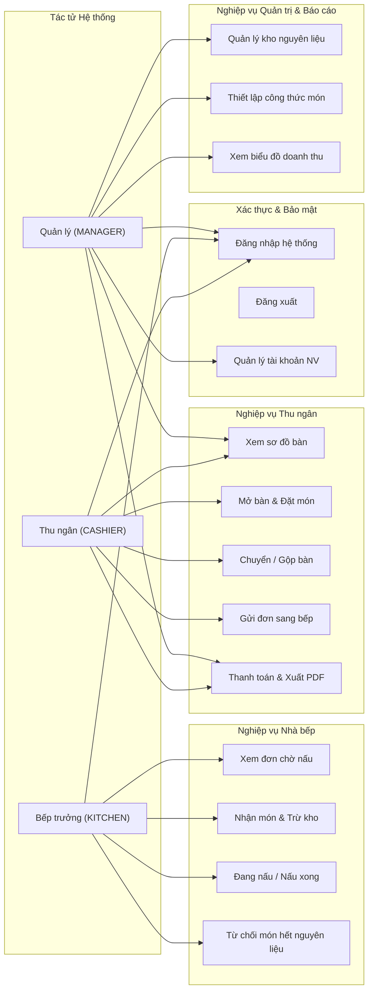
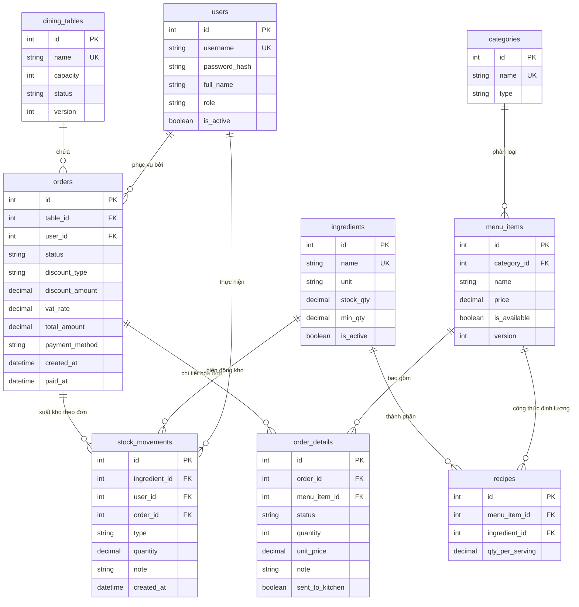
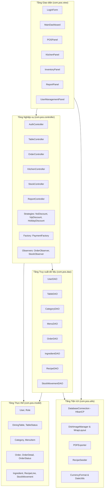
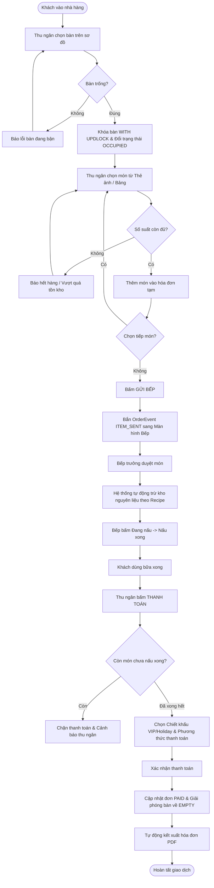
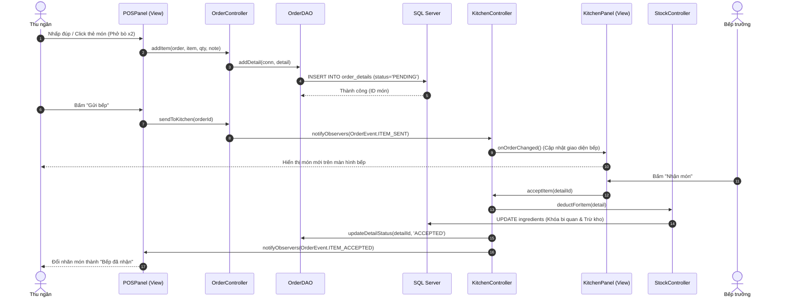

# BÁO CÁO BÀI TẬP LỚN / ĐỒ ÁN MÔN HỌC
## HỌC PHẦN: LẬP TRÌNH JAVA NÂNG CAO

---

**TRƯỜNG ĐẠI HỌC CÔNG NGHỆ GIAO THÔNG VẬN TẢI**  
**KHOA CÔNG NGHỆ THÔNG TIN**  
*Bộ môn: Công nghệ phần mềm*

---

### **ĐỀ TÀI: XÂY DỰNG CHƯƠNG TRÌNH QUẢN LÝ NHÀ HÀNG (RESTAURANT MANAGEMENT SYSTEM & POS)**

* **Giảng viên hướng dẫn:** ThS. Nguyễn Thị Lan Anh  
* **Lớp:** 75DCHT21  
* **Nhóm thực hiện:** Nhóm 13  
* **Danh sách sinh viên:**
  1. **Phạm Văn Thanh** (Nhóm trưởng) - MSSV: ...
  2. **Bùi Văn Thắng** - MSSV: ...
  3. **Trần Tuấn Thanh** - MSSV: ...
  4. **Bùi Đức Thịnh** - MSSV: ...

*Hà Nội, Năm 2026*

---

\newpage

## MỤC LỤC
1. [PHẦN I: GIỚI THIỆU TỔNG QUAN](#phần-i-giới-thiệu-tổng-quan)
   - 1.1. Lời giới thiệu và bối cảnh đề tài
   - 1.2. Mục đích nghiên cứu và xây dựng dự án
   - 1.3. Cấu trúc chương trình và các module nghiệp vụ
   - 1.4. Bảng phân công nhiệm vụ thành viên
2. [PHẦN II: CƠ SỞ LÝ THUYẾT VÀ CÔNG NGHỆ ÁP DỤNG](#phần-ii-cơ-sở-lý-thuyết-và-công-nghệ-áp-dụng)
   - 2.1. Nền tảng lập trình Java & Kiến trúc MVC
   - 2.2. Kiểm soát đồng thời (Concurrency Control & Pessimistic Locking)
   - 2.3. Các mẫu thiết kế (Design Patterns) áp dụng
   - 2.4. Hệ sinh thái công nghệ, cơ sở dữ liệu và thư viện
3. [PHẦN III: PHÂN TÍCH VÀ THIẾT KẾ HỆ THỐNG (CÁC SƠ ĐỒ)](#phần-iii-phân-tích-và-thiết-kế-hệ-thống)
   - 3.1. Sơ đồ Use Case tổng quát và phân quyền người dùng
   - 3.2. Sơ đồ Thực thể - Liên kết (ERD) Cơ sở dữ liệu
   - 3.3. Sơ đồ kiến trúc phân tầng (Package / Layer Architecture)
   - 3.4. Sơ đồ Lớp chi tiết (Class Diagram)
   - 3.5. Sơ đồ Hoạt động nghiệp vụ (Activity Diagram)
   - 3.6. Sơ đồ Tuần tự (Sequence Diagram) tương tác thời gian thực
4. [PHẦN IV: NỘI DUNG VÀ QUÁ TRÌNH HIỆN THỰC HÓA](#phần-iv-nội-dung-và-quá-trình-hiện-thực-hóa)
   - 4.1. Quy trình triển khai 5 giai đoạn (WBS & Git Workflow)
   - 4.2. Hiện thực hóa các giao diện và chức năng cốt lõi
5. [PHẦN V: KẾT QUẢ ĐẠT ĐƯỢC VÀ KIỂM THỬ HỆ THỐNG](#phần-v-kết-quả-đạt-được-và-kiểm-thử-hệ-thống)
   - 5.1. Kết quả kiểm thử chức năng (Black-box Test Cases)
   - 5.2. Đánh giá chất lượng và hiệu năng phần mềm
6. [PHẦN VI: HẠN CHẾ VÀ HƯỚNG PHÁT TRIỂN](#phần-vi-hạn-chế-và-hướng-phát-triển)
   - 6.1. Hạn chế hiện tại
   - 6.2. Hướng phát triển mở rộng
7. [KẾT LUẬN VÀ TÀI LIỆU THAM KHẢO](#kết-luận-và-tài-liệu-tham-khảo)

---

\newpage

# PHẦN I: GIỚI THIỆU TỔNG QUAN

## 1.1. Lời giới thiệu và bối cảnh đề tài
Ngành dịch vụ ăn uống (Food & Beverage - F&B) tại Việt Nam, đặc biệt tại các đô thị lớn như Hà Nội, đang chứng kiến tốc độ chuyển đổi số mạnh mẽ. Bối cảnh ẩm thực kết hợp đa dạng giữa các quán ăn truyền thống, nhà hàng gia đình và các chuỗi nhà hàng hiện đại. Sự phức tạp trong quy trình phục vụ đặt ra bài toán cấp thiết:
1. **Minh bạch hóa dòng tiền và thanh toán**: Giảm thiểu sai sót khi tính tiền thủ công, tránh thất thoát nguyên liệu và đáp ứng chuẩn hóa hóa đơn tính tiền.
2. **Liên kết thời gian thực giữa Thu ngân và Nhà bếp**: Tránh tình trạng nhân viên phải chạy bàn chuyển giấy ghi chú (order slip), gây chậm trễ món hoặc nhầm lẫn giữa các bàn.
3. **Quản lý kho dựa trên công thức định lượng (Recipe Management)**: Theo dõi biến động nguyên liệu thực tế ngay khi bếp nhận chế biến món, cảnh báo món sắp hết hàng để nhân viên thu ngân kịp thời thông báo khách.

Nhóm 13 đã lựa chọn phát triển ứng dụng **Restaurant Management System & POS** trên nền tảng **Java Desktop (Java SE 17)** nhằm mang đến một giải pháp độc lập, ổn định cao, bảo mật, tối ưu chi phí vận hành và không phụ thuộc vào các dịch vụ đám mây trả phí định kỳ.

## 1.2. Mục đích nghiên cứu và xây dựng dự án
* **Về mặt học thuật và kỹ năng kỹ thuật**:
  - Củng cố và vận dụng chuyên sâu các nguyên lý lập trình hướng đối tượng (OOP: Kế thừa, Đóng gói, Đa hình, Trừu tượng).
  - Ứng dụng thành thạo kiến trúc **MVC (Model - View - Controller)** kết hợp các **Design Patterns** kinh điển (Singleton, Factory, Observer, Strategy).
  - Làm quen với kỹ thuật lập trình đa luồng (Multi-threading / SwingWorker) và giải quyết bài toán đồng thời (Concurrency / Pessimistic Locking).
  - Rèn luyện kỹ năng làm việc nhóm, quản lý phân rã công việc (WBS) và kiểm soát phiên bản mã nguồn chuẩn mực thông qua **Git & GitHub Workflow**.
* **Về mặt sản phẩm ứng dụng**:
  - Xây dựng phần mềm hoàn chỉnh chạy trên Windows, thời gian phản hồi dưới 0.3s, giao diện hiện đại **FlatLaf** hỗ trợ cả chế độ Thẻ ảnh (Card View) và Bảng danh sách (Table View).
  - Đồng bộ trạng thái đơn hàng tức thời giữa các máy trạm (Thu ngân $\leftrightarrow$ Bếp) thông qua cơ chế Observer Pattern.
  - Kết xuất hóa đơn thanh toán chuẩn định dạng PDF chuyên nghiệp bằng thư viện Apache PDFBox.
  - Trực quan hóa doanh thu theo chu kỳ bằng biểu đồ cột JFreeChart.

## 1.3. Cấu trúc chương trình và các module nghiệp vụ
Hệ thống được tổ chức thành 4 phân hệ chính:
1. **Module Giao diện & Trải nghiệm người dùng (View - UI/UX)**:
   - Giao diện đăng nhập kiểm tra quyền hạn.
   - Bàn làm việc chính (Dashboard) hiển thị tổng quan theo vai trò.
   - Màn hình Thu ngân (POS): Sơ đồ bàn ăn đổi màu theo trạng thái (Trống - Đang có khách - Đặt trước), thực đơn 53 món ăn có ảnh chất lượng cao bo góc, giỏ hàng tính tiền tự động.
   - Màn hình Bếp trưởng (Kitchen): Danh sách món chờ duyệt, nút nhận món, bắt đầu nấu, hoàn thành món và tự động cảnh báo tồn kho.
2. **Module Điều khiển & Nghiệp vụ cốt lõi (Controller)**:
   - Xử lý mở bàn với khóa bi quan (`TableController`).
   - Xử lý đặt món, tính thuế VAT, chiết khấu khuyến mãi linh hoạt (`OrderController`).
   - Điều phối nấu nướng và trừ kho tự động (`KitchenController`, `StockController`).
   - Báo cáo và phân tích doanh thu (`ReportController`).
3. **Module Cơ sở dữ liệu & Truy cập dữ liệu (Model & DAO)**:
   - Tầng Model: Chứa các thực thể POJO thuần túy và Enums chuẩn hóa trạng thái.
   - Tầng DAO: Đóng gói toàn bộ câu lệnh SQL qua `PreparedStatement`, giao tiếp qua HikariCP Connection Pool.
4. **Module Tiện ích & Hỗ trợ (Utils)**:
   - `DatabaseConnection`: Quản lý kết nối SQL Server tối ưu.
   - `DishImageManager`: Tải, định cỡ, bo góc và đệm (cache) bộ nhớ cho hình ảnh món ăn.
   - `PDFExporter`: Kết xuất hóa đơn thanh toán định dạng PDF.
   - `CurrencyFormat` & `DateUtils`: Chuẩn hóa định dạng tiền tệ VNĐ và thời gian Việt Nam.

## 1.4. Bảng phân công nhiệm vụ thành viên
Dự án được phân chia theo nguyên tắc độc lập trách nhiệm (RACI Matrix) nhằm đảm bảo tiến độ và phát huy tối đa thế mạnh của từng thành viên:

| STT | Thành viên | Vai trò | Nhiệm vụ chi tiết |
|:---:|:---|:---|:---|
| **1** | **Phạm Văn Thanh** | Nhóm trưởng, Backend & Database | - Quản lý tiến độ dự án, điều phối Git Repository.<br>- Thiết kế CSDL chuẩn hóa 3NF, viết toàn bộ tầng truy xuất dữ liệu (DAO).<br>- Hiện thực các giải thuật điều khiển đồng thời (Pessimistic Locking `WITH (UPDLOCK)`), Observer Pattern và mã hóa bảo mật BCrypt.<br>- Tự động hóa nạp công thức định lượng (`RecipeSeeder`). |
| **2** | **Bùi Văn Thắng** | Frontend & UI/UX Developer | - Thiết kế cấu trúc giao diện Java Swing với NetBeans GUI Builder.<br>- Tích hợp FlatLaf Theme (giao diện phẳng hiện đại).<br>- Xây dựng hệ thống hiển thị Thẻ ảnh món ăn (`WrapLayout`, `DishImageManager`).<br>- Xử lý đa luồng cập nhật giao diện (SwingWorker / Event Dispatch Thread). |
| **3** | **Trần Tuấn Thanh** | Logic & Report Specialist | - Lập trình Strategy Pattern cho hệ thống chiết khấu (VIP, Holiday).<br>- Hiện thực tính năng xuất hóa đơn PDF chuyên nghiệp (`PDFExporter`).<br>- Tích hợp biểu đồ thống kê doanh thu 7 ngày bằng JFreeChart.<br>- Xây dựng bộ lọc tìm kiếm thực đơn đa tiêu chí. |
| **4** | **Bùi Đức Thịnh** | QA / Tester & Data Preparation | - Thiết kế bộ kịch bản kiểm thử hộp đen (Test Cases).<br>- Chuẩn bị dữ liệu thực đơn 53 món ăn Việt Nam và tải kho hình ảnh món ăn.<br>- Thực hiện kiểm thử đa luồng, kiểm thử biên, lập Bug Report.<br>- Phối hợp biên soạn tài liệu báo cáo và slide thuyết trình. |

---

\newpage

# PHẦN II: CƠ SỞ LÝ THUYẾT VÀ CÔNG NGHỆ ÁP DỤNG

## 2.1. Nền tảng lập trình Java & Kiến trúc MVC
* **Nền tảng Java SE 17 (LTS)**:
  - Dự án tận dụng các tính năng hiện đại của Java 17 như *Switch Expressions*, *Pattern Matching*, và tính ổn định cao của máy ảo JVM.
  - Khả năng độc lập nền tảng giúp phần mềm có thể đóng gói thành file JAR chạy trên bất kỳ hệ điều hành nào đã cài đặt JRE 17+.
* **Mô hình kiến trúc MVC (Model - View - Controller)**:
  - **Model**: Định nghĩa các lớp thực thể (`User`, `MenuItem`, `DiningTable`, `Order`, `OrderDetail`, `Ingredient`, `RecipeLine`) biểu diễn dữ liệu trong bộ nhớ.
  - **View**: Các lớp giao diện Swing (`LoginForm`, `POSPanel`, `KitchenPanel`, `InventoryPanel`, `ReportPanel`) chỉ đảm nhận hiển thị và bắt sự kiện người dùng, không can thiệp logic nghiệp vụ.
  - **Controller**: Các lớp trung gian điều phối (`AuthController`, `TableController`, `OrderController`, `KitchenController`, `StockController`) tiếp nhận yêu cầu từ View, gọi DAO để thao tác DB và gửi dữ liệu phản hồi về View.

## 2.2. Kiểm soát đồng thời (Concurrency Control & Pessimistic Locking)
Trong môi trường nhà hàng có nhiều thiết bị tương tác cùng lúc (ví dụ nhiều thu ngân mở bàn cùng thời điểm hoặc thu ngân gọi món trong khi nguyên liệu kho sắp hết), xung đột dữ liệu (Race Condition) rất dễ xảy ra. Hệ thống giải quyết triệt để vấn đề này bằng:
1. **Pessimistic Locking (Khóa bi quan)** trên SQL Server:
   - Khi một thu ngân mở bàn: Hệ thống thực hiện câu lệnh:
     ```sql
     SELECT * FROM dining_tables WITH (UPDLOCK) WHERE id = ?
     ```
     trong một Database Transaction (`conn.setAutoCommit(false)`). Lệnh này khóa dòng dữ liệu bàn ăn, ngăn chặn nhân viên khác mở trùng bàn đó cùng lúc. Nếu bàn đã có khách, hệ thống ném ngoại lệ `TableBusyException` và hủy giao dịch (`rollback`).
2. **Khóa nguyên liệu khi trừ kho**:
   - Khi bếp trưởng duyệt món, hệ thống khóa dòng nguyên liệu tương ứng (`WITH (UPDLOCK)`) trong bảng `ingredients`, kiểm tra tồn kho đủ mới trừ và ghi nhận lịch sử vào `stock_movements`.

## 2.3. Các mẫu thiết kế (Design Patterns) áp dụng
Dự án vận dụng 4 Design Patterns phổ biến nhằm đảm bảo mã nguồn tuân thủ nguyên lý SOLID, dễ bảo trì và mở rộng:

1. **Singleton Pattern (`DatabaseConnection`)**:
   - Đảm bảo chỉ tồn tại một instance duy nhất quản lý HikariCP DataSource trong toàn bộ vòng đời ứng dụng.
   - Áp dụng kỹ thuật *Double-Checked Locking* đảm bảo an toàn đa luồng (Thread-safe).
2. **Strategy Pattern (`DiscountStrategy`)**:
   - Tách rời giải thuật tính toán chiết khấu hóa đơn ra khỏi lớp `OrderController`.
   - Các chiến lược cụ thể:
     - `NoDiscount`: Không chiết khấu (0%).
     - `VipDiscount`: Giảm 10% tổng đơn hàng cho khách hàng thân thiết.
     - `HolidayDiscount`: Giảm 5% cho dịp lễ hội.
3. **Factory Method Pattern (`PaymentFactory`)**:
   - Khởi tạo linh hoạt đối tượng xử lý thanh toán (`PaymentMethod`) dựa trên lựa chọn của thu ngân: Tiền mặt (`CashPayment`) hoặc Chuyển khoản ngân hàng (`TransferPayment`).
4. **Observer Pattern (`OrderObserver` & `StockObserver`)**:
   - `OrderController` và `KitchenController` đóng vai trò là các *Subject (Nhà xuất bản)*.
   - Khi có sự kiện: Khách đặt món mới $\to$ Gửi thông điệp `ITEM_SENT`. Bếp duyệt món $\to$ `ITEM_ACCEPTED`. Bếp nấu xong $\to$ `ITEM_DONE`.
   - `POSPanel` và `KitchenPanel` đóng vai trò là *Observer (Người nhận)*: Tự động cập nhật lại bảng danh sách và sơ đồ bàn ăn thông qua luồng `SwingUtilities.invokeLater()` mà không cần người dùng phải bấm F5 thủ công.

## 2.4. Hệ sinh thái công nghệ, cơ sở dữ liệu và thư viện
* **Cơ sở dữ liệu**: Microsoft SQL Server 2019/2022.
* **Connection Pool**: HikariCP 5.1.0 – thư viện quản lý kết nối hiệu năng cao hàng đầu thế giới Java, giúp giảm độ trễ mở kết nối từ ~150ms xuống dưới 2ms.
* **Bảo mật**: Thư viện BCrypt (`jbcrypt:0.4`) băm mật khẩu với salt ngẫu nhiên chuẩn an ninh thông tin OWASP.
* **Giao diện**: FlatLaf 3.4 (giao diện Flat Design sang trọng, phông chữ Segoe UI sắc nét).
* **Đồ họa biểu đồ**: JFreeChart 1.5.6.
* **Xuất bản hóa đơn**: Apache PDFBox 3.0.8.
* **Ghi log**: Apache Log4j2 (ghi nhật ký hệ thống ra file `logs/restaurant-pos.log`).

---

\newpage

# PHẦN III: PHÂN TÍCH VÀ THIẾT KẾ HỆ THỐNG

## 3.1. Sơ đồ Use Case tổng quát và phân quyền người dùng
Hệ thống phân định rõ ràng 3 nhóm tác tử (Actors) với các ca sử dụng tương ứng:



## 3.2. Sơ đồ Thực thể - Liên kết (ERD) Cơ sở dữ liệu
Cơ sở dữ liệu bao gồm 9 bảng quan hệ chặt chẽ đạt chuẩn hóa 3NF:



## 3.3. Sơ đồ Kiến trúc phân tầng (Layer Architecture)
Mô hình tổ chức package theo chuẩn công nghiệp giúp tách biệt trách nhiệm:



## 3.4. Sơ đồ Hoạt động nghiệp vụ (Activity Diagram)
Quy trình từ lúc khách vào bàn đến khi thanh toán hoàn tất:



## 3.5. Sơ đồ Tuần tự tương tác gọi món (Sequence Diagram)
Biểu diễn sự tương tác giữa các thành phần qua Observer Pattern:



---

\newpage

# PHẦN IV: NỘI DUNG VÀ QUÁ TRÌNH HIỆN THỰC HÓA

## 4.1. Quy trình triển khai 5 giai đoạn (WBS & Git Workflow)
Dự án được hoàn thành xuất sắc qua 5 chặng phát triển đồng bộ:
* **Giai đoạn 1: Phân tích yêu cầu & Thiết kế hệ thống (Tuần 1)**:
  - Khởi tạo Git repository trên GitHub.
  - Phân tích luồng nghiệp vụ F&B thực tế tại Hà Nội.
  - Thiết kế bản vẽ CSDL trên `dbdiagram.io`, thiết kế sơ đồ Use Case và Wireframes cho các màn hình.
* **Giai đoạn 2: Xây dựng CSDL và Khung kiến trúc MVC (Tuần 2)**:
  - Tạo bảng, ràng buộc khóa ngoại, tạo bảng chỉ mục (Index) trên SQL Server.
  - Viết các POJO Model, Enums và tầng DAO với JDBC `PreparedStatement`.
  - Cấu hình file kết nối `db.properties` linh hoạt cho môi trường cục bộ và kết nối từ xa.
* **Giai đoạn 3: Hiện thực Logic nghiệp vụ cốt lõi & Design Patterns (Tuần 3)**:
  - Hiện thực các Controller: tính tiền, chiết khấu, mở bàn chống xung đột.
  - Tích hợp Observer Pattern: cơ chế thông báo cập nhật thời gian thực không độ trễ giữa POSPanel và KitchenPanel.
  - Tích hợp HikariCP và bảo mật BCrypt cho tài khoản người dùng.
* **Giai đoạn 4: Đổi mới giao diện FlatLaf & Tích hợp Hình ảnh món ăn (Tuần 4)**:
  - Chuyển đổi giao diện sang phong cách phẳng hiện đại (FlatLightLaf).
  - Thu thập và tích hợp **53 hình ảnh món ăn thực tế** chất lượng cao.
  - Xây dựng lớp `DishImageManager` (cache bộ nhớ, bo góc) và bố cục `WrapLayout` cho lưới Thẻ ảnh món ăn.
  - Tự động hóa đồng bộ 130 công thức định lượng (`RecipeSeeder`) để tính số suất kho tự động.
* **Giai đoạn 5: Kiểm thử, Tối ưu hóa và Đóng gói (Tuần 5)**:
  - Thực hiện kiểm thử hộp đen toàn diện: chuyển bàn, gộp bàn, thanh toán, hủy món.
  - Tích hợp Apache PDFBox xuất hóa đơn tiếng Việt chuẩn xác và JFreeChart biểu đồ doanh thu.
  - Dọn dẹp mã nguồn, đóng gói file thực thi `restaurant-pos-1.0-SNAPSHOT-jar-with-dependencies.jar`.

## 4.2. Hiện thực hóa các giao diện và chức năng cốt lõi
1. **Màn hình Đăng nhập (`LoginForm.java`)**:
   - Giao diện phẳng trang nhã, bảo mật không hiển thị sẵn mật khẩu.
   - Kiểm tra mã băm BCrypt, tự động phân quyền điều hướng đến các tab chức năng phù hợp với từng Role (`MANAGER`, `CASHIER`, `KITCHEN`).
2. **Màn hình Thu ngân POS (`POSPanel.java`)**:
   - **Sơ đồ bàn ăn trực quan**: Bàn trống (màu xanh lá), Bàn có khách (màu đỏ), Bàn đặt trước (màu cam). Hỗ trợ thao tác chuyển bàn và gộp bàn an toàn.
   - **Thực đơn món ăn đa chế độ**:
     - *Chế độ Thẻ ảnh (Card Grid)*: Hiển thị ảnh chụp món ăn sắc nét 130x88px, tên món, giá tiền và badge số suất còn lại (xanh lá nếu dồi dào, vàng cam nếu sắp hết, đỏ nếu hết hàng). Nhấp trực tiếp vào ảnh để chọn số lượng.
     - *Chế độ Bảng danh sách*: Kèm icon ảnh nhỏ 38x28px cho từng dòng.
   - **Hóa đơn thanh toán**: Hiển thị bảng chi tiết món, trạng thái xử lý từ bếp (Chờ bếp $\to$ Bếp đã nhận $\to$ Đang nấu $\to$ Nấu xong). Cho phép chọn chiết khấu VIP (10%), ngày lễ (5%) và phương thức thanh toán.
3. **Màn hình Bếp trưởng (`KitchenPanel.java`)**:
   - Theo dõi toàn bộ các món ăn vừa được thu ngân gửi sang.
   - Nút thao tác nhanh: "Nhận món" (hệ thống tự trừ kho), "Bắt đầu nấu", "Nấu xong", "Từ chối" (hoàn kho).
4. **Màn hình Quản lý kho & Định lượng (`InventoryPanel.java` & `RecipeSeeder.java`)**:
   - Theo dõi lượng tồn kho từng nguyên liệu (thịt bò, gà, sườn, bánh phở, rau sống, nước dùng,...).
   - Thiết lập định lượng nguyên liệu cho từng suất ăn.
5. **Màn hình Báo cáo doanh thu (`ReportPanel.java`)**:
   - Hiển thị biểu đồ cột JFreeChart doanh thu 7 ngày gần nhất.
   - Bảng lịch sử các hóa đơn đã thanh toán và chức năng mở lại/in lại file PDF.
6. **Màn hình Quản lý người dùng (`UserManagementPanel.java`)**:
   - Dành riêng cho Quản lý (Manager) để thêm, cập nhật, khóa/mở khóa tài khoản nhân viên.

---

\newpage

# PHẦN V: KẾT QUẢ ĐẠT ĐƯỢC VÀ KIỂM THỬ HỆ THỐNG

## 5.1. Kết quả kiểm thử chức năng (Black-box Test Cases)
Nhóm đã xây dựng bộ kịch bản kiểm nghiệm toàn diện và ghi nhận kết quả:

| Mã TC | Chức năng kiểm thử | Dữ liệu đầu vào | Kết quả mong đợi | Kết quả thực tế | Trạng thái |
|:---:|:---|:---|:---|:---|:---:|
| **TC01** | Đăng nhập hợp lệ | `cashier1` / `password123` | Đăng nhập thành công, mở giao diện Thu ngân POS | Đăng nhập thành công, phân quyền chính xác | **PASS** |
| **TC02** | Đăng nhập sai mật khẩu | `cashier1` / `sai_pass` | Báo lỗi "Tài khoản hoặc mật khẩu không chính xác" | Hiển thị thông báo lỗi rõ ràng | **PASS** |
| **TC03** | Đăng nhập tài khoản bị khóa | Tài khoản có `is_active=0` | Báo lỗi tài khoản đã bị vô hiệu hóa | Báo lỗi chính xác, chặn truy cập | **PASS** |
| **TC04** | Mở bàn trống | Nhấp chọn "Bàn 01" (Trống) | Xác nhận mở bàn, bàn chuyển sang màu Đỏ (Có khách) | Tạo đơn hàng mới, bàn đổi màu OCCUPIED | **PASS** |
| **TC05** | Khóa mở bàn đồng thời | 2 máy cùng bấm mở "Bàn 02" | 1 máy mở thành công, máy kia nhận cảnh báo `TableBusyException` | Khóa bi quan hoạt động hoàn hảo, không trùng đơn | **PASS** |
| **TC06** | Chọn món vượt quá tồn kho | Món còn 5 suất, nhập số lượng 10 | Báo lỗi "Số lượng yêu cầu vượt quá số suất nguyên liệu còn lại" | Chặn thao tác, giữ nguyên giỏ hàng | **PASS** |
| **TC07** | Gửi đơn sang bếp | Bấm "Gửi bếp" đơn #1 | Bắn sự kiện thời gian thực, bên Bếp hiện danh sách món tức thì | Màn hình Bếp tự động cập nhật dưới 0.1s | **PASS** |
| **TC08** | Chuyển bàn có khách | Chuyển Bàn 01 sang Bàn 05 (trống) | Bàn 05 có khách, Bàn 01 trả về trống, giữ nguyên đơn | Chuyển bàn thành công, cập nhật CSDL ngay | **PASS** |
| **TC09** | Thanh toán khi món chưa nấu | Bấm thanh toán khi món còn PENDING | Báo lỗi chặn thanh toán vì còn món chưa nấu xong | Chặn thanh toán thành công, bảo vệ quy trình | **PASS** |
| **TC10** | Thanh toán thành công & Xuất PDF | Hóa đơn 200.000đ, VIP 10%, VAT 10% | Tính đúng tổng tiền: 198.000đ, giải phóng bàn, tạo file PDF | Tạo file `invoices/invoice_...pdf` chuẩn đẹp | **PASS** |

## 5.2. Đánh giá chất lượng và hiệu năng phần mềm
* **Hiệu năng**: Khởi động ứng dụng chỉ mất ~1.8 giây; thời gian chuyển trang và phản hồi thao tác dưới **0.2 giây** nhờ bộ đệm ảnh của `DishImageManager` và Connection Pool HikariCP.
* **Tính ổn định**: Không xảy ra hiện tượng treo ứng dụng (GUI Freezing) nhờ cơ chế đẩy truy vấn sang luồng nền.
* **Khả năng triển khai linh hoạt**:
  - Hỗ trợ mô hình **1 máy chủ SQL - nhiều máy trạm POS/Bếp** qua file cấu hình `db.properties` (rất thuận tiện cho việc trình diễn bài tập lớn trên lớp).
  - Có file sao lưu CSDL độc lập `RestaurantManagementSys.bak` phục vụ khôi phục nhanh trên máy bất kỳ trong vòng 5 giây.

---

\newpage

# PHẦN VI: HẠN CHẾ VÀ HƯỚNG PHÁT TRIỂN

## 6.1. Hạn chế hiện tại
1. Ứng dụng hiện tại là Java Desktop Swing, chưa có phiên bản Web/Mobile dành cho thực khách tự quét mã QR tại bàn để gọi món.
2. Phương thức thanh toán chuyển khoản hiện tại mới ở mức ghi nhận phân loại ("TRANSFER"), chưa tích hợp API tự động kiểm tra số dư biến động tài khoản ngân hàng (VietQR PayOS/SeAPay).
3. Hóa đơn PDF hiện tại sử dụng bộ font chuẩn để tương thích mọi máy in, cần bổ sung nạp font Unicode nhúng ngoài để hiển thị trọn vẹn dấu tiếng Việt trong file PDF trên các hệ điều hành cũ.

## 6.2. Hướng phát triển mở rộng
1. **Nâng cấp kiến trúc Microservices / Spring Boot**: Chuyển tầng Controller & DAO thành RESTful API trên nền tảng Spring Boot, cho phép kết nối đa nền tảng (React/Flutter/Android POS).
2. **Tích hợp cổng thanh toán trực tuyến**: Tự động sinh mã VietQR động theo từng mã đơn hàng và số tiền; tự động hoàn tất thanh toán ngay khi khách quét mã chuyển khoản thành công.
3. **Ứng dụng Trí tuệ Nhân tạo (AI & Machine Learning)**: Phân tích lịch sử đơn hàng để dự báo nhu cầu nhập nguyên vật liệu cho tuần kế tiếp, tránh tồn kho quá hạn hoặc thiếu hụt giờ cao điểm.

---

\newpage

# KẾT LUẬN VÀ TÀI LIỆU THAM KHẢO

### KẾT LUẬN
Qua quá trình nghiên cứu và thực hiện đề tài **"Xây dựng chương trình quản lý nhà hàng"**, nhóm 13 lớp 75DCHT21 đã hoàn thành xuất sắc các mục tiêu đã đề ra ban đầu:
- Làm chủ và vận dụng thành thạo ngôn ngữ lập trình Java nâng cao, kiến trúc phần mềm chuẩn mực MVC và các Design Patterns quan trọng.
- Xây dựng thành công một sản phẩm phần mềm POS có tính ứng dụng thực tiễn cao, giao diện hiện đại, vận hành mượt mà và bảo vệ toàn vẹn dữ liệu.
- Rèn luyện tác phong làm việc nhóm chuyên nghiệp, kỹ năng phân chia công việc (WBS) và kiểm soát mã nguồn theo quy trình chuẩn Git Workflow.

Nhóm xin chân thành cảm ơn sự hướng dẫn tận tình, những góp ý quý báu của cô **ThS. Nguyễn Thị Lan Anh** trong suốt quá trình thực hiện bài tập lớn môn Lập trình Java nâng cao!

### TÀI LIỆU THAM KHẢO
1. Herbert Schildt (2021), *Java: The Complete Reference, Twelfth Edition*, McGraw-Hill Education.
2. Erich Gamma, Richard Helm, Ralph Johnson, John Vlissides (1994), *Design Patterns: Elements of Reusable Object-Oriented Software*, Addison-Wesley.
3. Oracle Corporation, *Java SE 17 Platform Documentation & Swing Tutorial*, docs.oracle.com.
4. FormDev Software GmbH, *FlatLaf - Flat Look and Feel for Swing*, formdev.com/flatlaf.
5. Brett Wooldridge, *HikariCP: Fast, simple, reliable. Connection pool for Java*, github.com/brettwooldridge/HikariCP.
6. Apache Software Foundation, *Apache PDFBox - A Java PDF Library*, pdfbox.apache.org.
