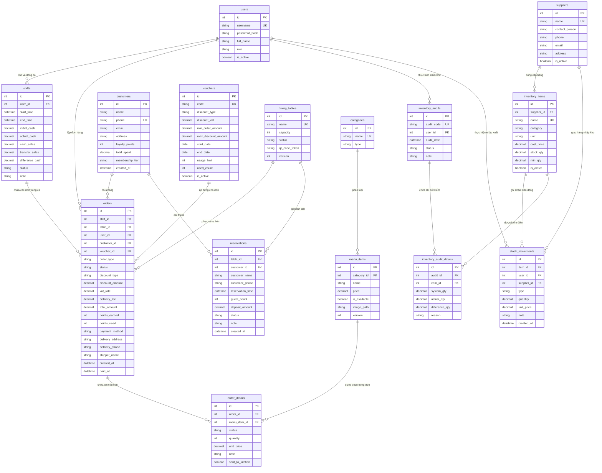
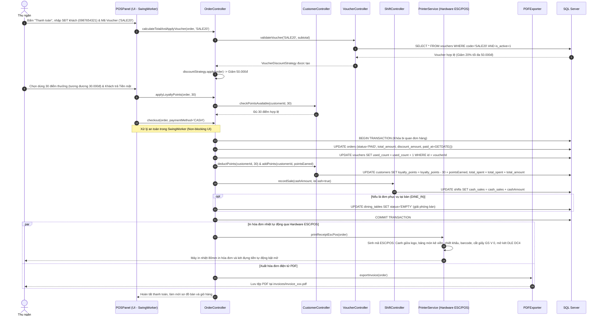
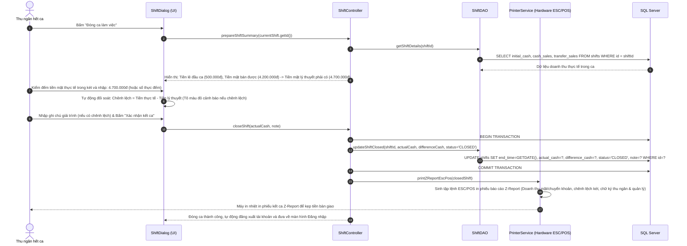

# TÀI LIỆU THIẾT KẾ KIẾN TRÚC HỆ THỐNG (SYSTEM DESIGN SPECIFICATION)
## DỰ ÁN: HỆ THỐNG QUẢN LÝ NHÀ HÀNG & ĐIỂM BÁN HÀNG ĐA KÊNH (RESTAURANT MANAGEMENT & OMNICHANNEL POS)
**Phiên bản:** 3.0 (Enterprise Refactored Edition - 12 Modules)  
**Nền tảng công nghệ:** Java SE 17, Java Swing, FlatLaf Modern Look & Feel (Bo góc & SVG Icons, Multi-threading SwingWorker), Microsoft SQL Server, Hardware ESC/POS Driver, Apache PDFBox, JFreeChart

---

## 1. TỔNG QUAN KIẾN TRÚC TÁI CẤU TRÚC 3.0 (ENTERPRISE ARCHITECTURE OVERVIEW)

Hệ thống được thiết kế và tái cấu trúc hoàn chỉnh theo chuẩn kiến trúc Doanh nghiệp (Enterprise), phân tách rạch ròi thành **12 Module độc lập**, tuân thủ nguyên tắc Single Responsibility (SRP) và Separation of Concerns (SoC):

* **Tối ưu Giao diện (UI/UX) & Đa luồng (Multi-threading)**:
  - Giao diện phẳng cao cấp **FlatLaf**: áp dụng chuẩn bo góc toàn diện (`arc=12px` cho Button, Text field, Table card, Dialog), biểu tượng vector **SVG Icons** sắc nét trên mọi độ phân giải.
  - Bố cục Dashboard **Responsive**: tự động co giãn thích ứng kích thước cửa sổ với `WrapLayout` và `GridBagLayout`.
  - Cơ chế **Đa luồng chống đơ (Non-blocking SwingWorker)**: 100% các tác vụ gọi cơ sở dữ liệu, nạp danh sách thực đơn, đồng bộ Observer, in nhiệt ESC/POS và xuất hóa đơn PDF đều được đẩy xuống luồng nền (background worker thread), đảm bảo luồng giao diện chính (Event Dispatch Thread - EDT) tuyệt đối mượt mà, không bị lag/freeze.
* **Đơn giản hóa Quản lý kho (Inventory Management)**:
  - **Xóa bỏ hoàn toàn bảng `recipes` và các lớp công thức định lượng chi tiết**: Thực tế nhà hàng không thể cân đo chính xác từng thìa muối, gram hạt nêm hay lít nước dùng cho từng bát phở. Hệ thống chuyển sang quản lý tồn kho theo các hàng hóa, nguyên vật liệu và bán thành phẩm dễ đếm (lon nước, chai bia, gói nguyên liệu, bao gạo, túi cà phê, kg thịt đóng khay...).
  - Bổ sung bảng **`suppliers` (Nhà cung cấp)**: Quản lý thông tin nhà cung cấp và truy xuất nguồn gốc hàng nhập.
  - Bổ sung tính năng **Kiểm kho định kỳ (Inventory Audit / Stocktake)** với bảng `inventory_audits` và `inventory_audit_details`: cho phép đối soát số lượng thực tế đếm được trong kho với số lượng trên phần mềm, tự động tính chênh lệch thừa/thiếu và tạo phiếu cân bằng kho tự động.
* **Nâng cấp Module Máy in Hóa đơn Nhiệt (Hardware - Printer Service)**:
  - Xây dựng lớp dịch vụ phần cứng `PrinterService` hỗ trợ chuẩn tập lệnh **ESC/POS** quốc tế.
  - Tự động in hóa đơn nhiệt vật lý (khổ 80mm / 58mm) ngay khi thu ngân thanh toán thành công, song song với xuất file hóa đơn điện tử PDF.
* **Nâng cấp Đặt bàn trước (Reservations) & Mã QR tại bàn**:
  - Thêm bảng `reservations` hỗ trợ đặt bàn trước theo ngày giờ cụ thể, lưu tiền cọc, số khách và ghi chú.
  - Tích hợp tạo mã QR độc nhất tại từng bàn để khách quét xem thực đơn điện tử (E-Menu) hoặc đặt bàn.
* **Thêm Module Quản lý Ca làm việc & Bàn giao két tiền (Shift & Cash Drawer Management)**:
  - Thêm bảng `shifts`. Thu ngân bắt buộc phải **Mở ca** (nhập tiền mặt ban đầu / float cash) trước khi bán hàng và **Đóng ca** (kiểm đếm tiền két thực tế để tính chênh lệch thừa/thiếu, in phiếu Z-Report kết ca).
* **Thêm Phân hệ Bán mang về & Giao hàng (Takeaway & Delivery)**:
  - Phân loại đơn hàng đa kênh: `DINE_IN` (Tại bàn), `TAKEAWAY` (Mang về), `DELIVERY` (Giao hàng).
  - Đơn mang về và giao hàng không bắt buộc gán bàn ăn (`table_id` có thể NULL).
  - Hỗ trợ lưu thông tin địa chỉ giao hàng, số điện thoại người nhận, phí vận chuyển (`delivery_fee`) và tên shipper.
* **Thêm Module Khách hàng (CRM) & Khuyến mãi động (Vouchers)**:
  - Bảng `customers`: Quản lý thông tin khách, tích điểm thưởng (`loyalty_points`), tích lũy chi tiêu và nâng hạng hội viên (`STANDARD`, `SILVER`, `GOLD`, `DIAMOND`).
  - Bảng `vouchers`: Quản lý mã giảm giá động (theo % hoặc số tiền cố định, giá trị đơn tối thiểu, mức giảm tối đa, hạn sử dụng, số lượt dùng).
  - Tích hợp `VoucherDiscountStrategy` vào mẫu thiết kế Strategy Pattern để tính toán giảm giá theo mã voucher.

---

## 2. BẢN TÓM TẮT 12 MODULE CHÍNH VÀ DANH MỤC TÍNH NĂNG CHI TIẾT

```
RESTAURANT MANAGEMENT SYSTEM (ENTERPRISE POS v3.0)
│
├── [Module 1] Quản trị Hệ thống & Người dùng (Authentication & User Management)
├── [Module 2] Bảng điều khiển Tổng quan (Dashboard & Overview)
├── [Module 3] Quản lý Ca làm việc & Két tiền (Shift & Cash Drawer Module)
├── [Module 4] Quản lý Thực đơn & Danh mục (Menu & Catalog Management)
├── [Module 5] Sơ đồ Bàn ăn & Mã QR (Dining Table & QR Code Module)
├── [Module 6] Đặt bàn trước (Reservation Management)
├── [Module 7] Bán hàng đa kênh (Omnichannel POS: Dine-in, Takeaway, Delivery)
├── [Module 8] Điều phối Bếp & Bar (Kitchen Display System - KDS)
├── [Module 9] Khách hàng thân thiết & Khuyến mãi (CRM & Dynamic Vouchers)
├── [Module 10] Quản lý Kho, Nhà cung cấp & Kiểm kê (Inventory, Supplier & Stocktake)
├── [Module 11] Thiết bị Ngoại vi & In ấn (Hardware: ESC/POS Thermal Printer)
└── [Module 12] Báo cáo Thống kê & Phân tích (Analytics, BI & Reporting Module)
```

### [Module 1] Quản trị Hệ thống & Người dùng (Authentication & User Management)
* **Xác thực an toàn (Authentication)**: Đăng nhập, đăng xuất, đổi mật khẩu được mã hóa băm an toàn **BCrypt** (salt ngẫu nhiên chuẩn an ninh OWASP).
* **Phân quyền dựa trên vai trò (Role-Based Access Control - RBAC)**:
  * `MANAGER`: Quản lý toàn diện hệ thống, nhân viên, ca làm việc, kho hàng, khách hàng, voucher khuyến mãi, báo cáo tài chính.
  * `CASHIER`: Quản lý ca làm việc, sơ đồ bàn, đặt bàn, bán hàng đa kênh, áp dụng voucher/điểm thưởng, in hóa đơn và thanh toán.
  * `KITCHEN`: Truy cập màn hình bếp trưởng KDS, tiếp nhận món, cập nhật tiến độ nấu nướng và báo hết món.
* **Quản lý danh sách nhân viên**: Thêm mới nhân viên, cập nhật thông tin cá nhân, phân quyền vai trò, khóa hoặc mở khóa tài khoản.

### [Module 2] Bảng điều khiển Tổng quan (Dashboard & Overview)
* **Giao diện Responsive**: Tự động co giãn theo kích thước cửa sổ ngay sau khi đăng nhập.
* **Các thẻ chỉ số KPI trực quan**: Doanh thu ngày, tổng đơn hàng, số bàn đang phục vụ, số khách đang đặt trước, đơn giao hàng đang xử lý, cảnh báo kho.
* **Biểu đồ doanh thu mini theo khung giờ**: Giúp nhà hàng nhận diện giờ cao điểm tức thời.

### [Module 3] Quản lý Ca làm việc & Két tiền (Shift & Cash Drawer Module)
* **Mở ca làm việc (Open Shift)**: Thu ngân bắt buộc phải mở ca, nhập số tiền lẻ ban đầu có trong két (`initial_cash` / tiền float).
* **Theo dõi dòng tiền trong ca**: Tự động phân loại tổng tiền mặt (`cash_sales`) và tiền chuyển khoản (`transfer_sales`). Chặn các thu ngân khác can thiệp giao dịch nếu chưa bàn giao.
* **Đóng ca & Kết sổ két tiền (Close Shift & Cash Audit)**: Thu ngân nhập số tiền mặt thực tế. Hệ thống tự động tính toán chênh lệch (Thừa/Thiếu tiền) và yêu cầu ghi chú giải trình.
* **In phiếu kết ca (Z-Report)**: Tự động xuất phiếu in nhiệt báo cáo doanh thu ca để bàn giao.

### [Module 4] Quản lý Thực đơn & Danh mục (Menu & Catalog Management)
* **Phân loại danh mục**: Quản lý các nhóm đồ ăn, thức uống (`categories`).
* **Quản lý chi tiết món ăn (Menu Items)**: Tên món, hình ảnh đại diện, giá bán, mô tả, và cài đặt trạng thái (`is_available`) để ẩn/hiện trên máy POS ngay lập tức.

### [Module 5] Sơ đồ Bàn ăn & Mã QR (Dining Table & QR Code Module)
* **Quản lý sơ đồ bàn trực quan theo thời gian thực**: Mã màu trạng thái rõ ràng (Xanh lá - `EMPTY`, Đỏ - `OCCUPIED`, Vàng cam - `RESERVED`). Hiển thị số ghế và mã bàn.
* **Mã QR Bàn ăn (Table QR Code)**: Tự động sinh mã QR độc nhất cho từng bàn dựa trên Token bảo mật. Khách quét mã để xem E-Menu. Hỗ trợ in hàng loạt QR để dán bàn.
* **Nghiệp vụ bàn**: Chuyển toàn bộ món sang bàn khác, Gộp bàn vào chung một hóa đơn. Áp dụng khóa bi quan (`Pessimistic Locking WITH (UPDLOCK)`) chống xung đột thao tác.

### [Module 6] Đặt bàn trước (Reservation Management)
* **Đặt bàn trước nhiều ngày**: Chọn khung giờ đến cụ thể, chọn bàn mong muốn.
* **Lưu trữ thông tin khách**: Tên khách hàng, số điện thoại, số khách, tiền đặt cọc (`deposit_amount`), ghi chú sự kiện.
* **Quản lý trạng thái lịch đặt**: `PENDING` $\to$ `CONFIRMED` $\to$ `SEATED` $\to$ `CANCELLED`.
* **Nhận bàn tự động**: Khi bấm "Nhận bàn" (`SEATED`), tự động đổi trạng thái bàn sang `OCCUPIED`, mở đơn hàng mới và chuyển tiền cọc vào hóa đơn.

### [Module 7] Bán hàng đa kênh (Omnichannel POS)
* **Phân loại hình thức bán hàng**: `DINE_IN` (Tại bàn), `TAKEAWAY` (Mang về - in phiếu số thứ tự), `DELIVERY` (Giao hàng - lưu địa chỉ, phí ship, tên shipper).
* **Thực đơn hiển thị kép**: Chế độ Lưới Thẻ ảnh (Card Grid) và Chế độ Bảng danh sách (Table List) tối ưu thao tác.
* **Giỏ hàng & Chi tiết hóa đơn linh hoạt**: Thêm món nhanh, tăng giảm số lượng, thêm ghi chú chế biến (ít cay, không đường...). Hủy món có kiểm quyền.
* **Tính toán thanh toán tự động**: Tính Tạm tính, Phí giao hàng, Thuế VAT (10%) và Tổng tiền cuối cùng. Áp dụng giảm giá.

### [Module 8] Điều phối Bếp & Bar (Kitchen Display System - KDS)
* **Màn hình KDS thời gian thực**: Nhận thông báo đơn món ngay lập tức khi thu ngân bấm "Gửi bếp" (Observer Pattern).
* **Quy trình luân chuyển trạng thái món**: `PENDING` (Chờ bếp) $\to$ `ACCEPTED` (Bếp nhận món) $\to$ `COOKING` (Đang nấu) $\to$ `DONE` (Sẵn sàng phục vụ) / `REJECTED` (Báo hết).
* **Kiểm soát thanh toán**: Chặn thu ngân thanh toán hóa đơn nếu vẫn còn món chưa làm xong (`PENDING`/`COOKING`).

### [Module 9] Khách hàng thân thiết & Khuyến mãi (CRM & Dynamic Vouchers)
* **Quản lý khách hàng (CRM)**: Lưu thông tin, tìm kiếm nhanh bằng SĐT.
* **Điểm thưởng & Hạng hội viên**: Tích lũy điểm theo doanh thu. Thăng hạng (`STANDARD`, `SILVER`, `GOLD`, `DIAMOND`). Dùng điểm trừ tiền hóa đơn.
* **Quản lý Mã khuyến mãi động (Dynamic Vouchers)**: Tạo mã theo % hoặc VNĐ, mức giảm tối đa, đơn tối thiểu, hạn sử dụng. Tích hợp Strategy Pattern để tính tự động.

### [Module 10] Quản lý Kho, Nhà cung cấp & Kiểm kê (Inventory, Supplier & Stocktake)
* **Quản lý danh mục hàng hóa dễ đếm**: Đóng lon, chai, bao gói (bỏ hoàn toàn định lượng recipe phức tạp).
* **Quản lý Nhà cung cấp (Suppliers)**: Lưu thông tin công ty, liên hệ, lịch sử nhập hàng.
* **Nhập/Xuất kho**: Lập phiếu nhập/xuất cập nhật tồn kho tức thì. Cảnh báo mặt hàng chạm ngưỡng tồn tối thiểu.
* **Kiểm kho định kỳ (Stocktake)**: Nhân viên đếm số lượng thực tế, hệ thống tính độ lệch (Thừa/Thiếu) và sinh phiếu điều chỉnh (`ADJUST_AUDIT`).

### [Module 11] Thiết bị Ngoại vi & In ấn (Hardware: ESC/POS Thermal Printer)
* **Lớp Dịch vụ độc lập (`PrinterService`)**: Hỗ trợ máy in hóa đơn nhiệt khổ 80mm / 58mm qua cổng USB, LAN.
* **Định dạng phiếu in chuyên nghiệp**: Canh giữa, logo, chi tiết món kẻ viền, in mã QR chuyển khoản.
* **Tự động gửi lệnh cắt giấy (`GS V 0`) và mở két tiền tự động (`DLE DC4`)** ngay khi thu ngân chốt đơn.
* **Xuất hóa đơn điện tử PDF**: Xuất file bằng Apache PDFBox phục vụ lưu trữ số.

### [Module 12] Báo cáo Thống kê & Phân tích (Analytics, BI & Reporting Module)
* **Trực quan hóa doanh thu**: Biểu đồ cột/tròn JFreeChart phân tích doanh thu theo ngày, tuần, hình thức bán, phương thức thanh toán.
* **Báo cáo mặt hàng bán chạy (Top-selling items)**.
* **Lịch sử hóa đơn**: Tra cứu và cho phép in lại hóa đơn bất kỳ lúc nào.

---

## 3. SƠ ĐỒ THIẾT KẾ HỆ THỐNG MỚI (MERMAID SPECIFICATIONS - 12 MODULES)

### 3.1. Sơ đồ Thực thể - Liên kết (ERD) - Phiên bản 3.0 Chuẩn 3NF



---

### 3.2. Sơ đồ Ca sử dụng (Use Case Diagram) - Tách biệt rõ ràng 12 Module

```mermaid
flowchart LR
    subgraph Actors["Tác nhân Hệ thống"]
        Cashier["Thu ngân (CASHIER)"]
        Kitchen["Bếp trưởng (KITCHEN)"]
        Manager["Quản lý (MANAGER)"]
    end

    subgraph M1["Module 1: Quản trị Hệ thống & Người dùng"]
        UC_Login["Đăng nhập / Đổi mật khẩu"]
        UC_UserMgmt["Quản lý tài khoản & Phân quyền RBAC"]
    end

    subgraph M2["Module 2: Bảng điều khiển Tổng quan (Dashboard)"]
        UC_ViewKPI["Xem thẻ chỉ số KPI & Cảnh báo nhanh"]
        UC_HourlyChart["Xem biểu đồ doanh thu theo giờ"]
    end

    subgraph M3["Module 3: Quản lý Ca làm việc & Két tiền"]
        UC_OpenShift["Mở ca & Khai báo tiền lẻ két"]
        UC_TrackCash["Theo dõi doanh thu tiền mặt / CK trong ca"]
        UC_CloseShift["Đóng ca, Đối soát chênh lệch & In Z-Report"]
    end

    subgraph M4["Module 4: Quản lý Thực đơn & Danh mục"]
        UC_CategoryMgmt["Quản lý Danh mục món ăn"]
        UC_MenuItemMgmt["Thêm / Sửa món & Bật tắt trạng thái bán"]
    end

    subgraph M5["Module 5: Sơ đồ Bàn ăn & Mã QR"]
        UC_ViewTables["Xem sơ đồ bàn trực quan (Mã màu)"]
        UC_TableQR["Tạo, Quét & In mã QR tại bàn"]
        UC_MoveMerge["Chuyển bàn / Gộp bàn (Khóa bi quan)"]
    end

    subgraph M6["Module 6: Đặt bàn trước (Reservation Management)"]
        UC_CreateRes["Đặt bàn trước theo ngày giờ & Nhận cọc"]
        UC_ConfirmSeated["Xác nhận khách đến & Nhận bàn (SEATED)"]
        UC_CancelRes["Hủy lịch đặt bàn"]
    end

    subgraph M7["Module 7: Bán hàng đa kênh (Omnichannel POS)"]
        UC_DineIn["Bán tại bàn (Dine-in)"]
        UC_Takeaway["Bán mang về (Takeaway - In số chờ)"]
        UC_Delivery["Bán giao hàng (Delivery - Phí ship & Shipper)"]
        UC_CartMgmt["Thêm món (Thẻ ảnh/Bảng) & Ghi chú chế biến"]
    end

    subgraph M8["Module 8: Điều phối Bếp & Bar (KDS)"]
        UC_ReceiveOrder["Nhận đơn gọi món thời gian thực (Observer)"]
        UC_UpdateCooking["Cập nhật trạng thái: Nhận -> Nấu -> Nấu xong"]
        UC_RejectItem["Từ chối món / Báo hết hàng"]
    end

    subgraph M9["Module 9: Khách hàng thân thiết & Khuyến mãi"]
        UC_CustomerCRM["Quản lý Khách hàng, Tích điểm & Thăng hạng"]
        UC_VoucherMgmt["Thiết lập Mã Voucher khuyến mãi động"]
        UC_ApplyDiscount["Áp dụng Voucher & Trừ điểm thưởng"]
    end

    subgraph M10["Module 10: Quản lý Kho, Nhà cung cấp & Kiểm kê"]
        UC_SupplierMgmt["Quản lý danh mục Nhà cung cấp"]
        UC_StockInOut["Nhập hàng theo NCC / Xuất kho"]
        UC_StockAudit["Kiểm kê kho & Tự động cân bằng kho"]
        UC_LowStockAlert["Cảnh báo hàng chạm ngưỡng tồn tối thiểu"]
    end

    subgraph M11["Module 11: Thiết bị Ngoại vi & In ấn (Hardware)"]
        UC_PrintReceipt["In hóa đơn nhiệt tự động ESC/POS (80mm)"]
        UC_OpenDrawer["Bật xung mở két tiền tự động"]
        UC_ExportPDF["Xuất hóa đơn điện tử định dạng PDF"]
    end

    subgraph M12["Module 12: Báo cáo Thống kê & Phân tích (BI)"]
        UC_RevenueReport["Xem biểu đồ doanh thu JFreeChart"]
        UC_TopSelling["Báo cáo món bán chạy nhất"]
        UC_ReprintInvoice["Tra cứu & In lại hóa đơn cũ"]
    end

    %% LIÊN KẾT THU NGÂN (CASHIER)
    Cashier --> UC_Login
    Cashier --> UC_ViewKPI
    Cashier --> UC_OpenShift
    Cashier --> UC_TrackCash
    Cashier --> UC_CloseShift
    Cashier --> UC_ViewTables
    Cashier --> UC_TableQR
    Cashier --> UC_MoveMerge
    Cashier --> UC_CreateRes
    Cashier --> UC_ConfirmSeated
    Cashier --> UC_DineIn
    Cashier --> UC_Takeaway
    Cashier --> UC_Delivery
    Cashier --> UC_CartMgmt
    Cashier --> UC_ApplyDiscount
    Cashier --> UC_PrintReceipt
    Cashier --> UC_OpenDrawer
    Cashier --> UC_ReprintInvoice

    %% LIÊN KẾT NHÀ BẾP (KITCHEN)
    Kitchen --> UC_Login
    Kitchen --> UC_ReceiveOrder
    Kitchen --> UC_UpdateCooking
    Kitchen --> UC_RejectItem

    %% LIÊN KẾT QUẢN LÝ (MANAGER)
    Manager --> UC_Login
    Manager --> UC_UserMgmt
    Manager --> UC_ViewKPI
    Manager --> UC_HourlyChart
    Manager --> UC_OpenShift
    Manager --> UC_CloseShift
    Manager --> UC_CategoryMgmt
    Manager --> UC_MenuItemMgmt
    Manager --> UC_ViewTables
    Manager --> UC_CreateRes
    Manager --> UC_CancelRes
    Manager --> UC_CustomerCRM
    Manager --> UC_VoucherMgmt
    Manager --> UC_SupplierMgmt
    Manager --> UC_StockInOut
    Manager --> UC_StockAudit
    Manager --> UC_LowStockAlert
    Manager --> UC_ExportPDF
    Manager --> UC_RevenueReport
    Manager --> UC_TopSelling
    Manager --> UC_ReprintInvoice
```



---

### 3.3. Sơ đồ Lớp chi tiết (Class Diagram) - Kiến trúc MVC & Design Patterns phân bổ theo 12 Module

```mermaid
classDiagram
    %% MODULE 1 & 2: USER, AUTH & DASHBOARD
    class User {
        -int id
        -String username
        -String passwordHash
        -String fullName
        -Role role
        -boolean active
        +hasPermission(String perm) boolean
    }
    class AuthController {
        -UserDAO userDAO
        +login(String user, String pass) User
        +changePassword(int userId, String oldPass, String newPass) boolean
    }

    %% MODULE 3: SHIFT & CASH DRAWER
    class Shift {
        -int id
        -User cashier
        -LocalDateTime startTime
        -LocalDateTime endTime
        -BigDecimal initialCash
        -BigDecimal actualCash
        -BigDecimal cashSales
        -BigDecimal transferSales
        -BigDecimal differenceCash
        -ShiftStatus status
        -String note
        +isOpen() boolean
        +calculateDiscrepancy() BigDecimal
    }
    class ShiftController {
        -ShiftDAO shiftDAO
        -PrinterService printerService
        -Shift currentShift
        +openShift(User cashier, BigDecimal initialCash) Shift
        +closeShift(BigDecimal actualCash, String note) Shift
        +recordSale(BigDecimal amount, boolean isCash) void
        +getCurrentShift() Shift
    }

    %% MODULE 4, 5 & 6: MENU, TABLE & RESERVATION
    class MenuItem {
        -int id
        -Category category
        -String name
        -BigDecimal price
        -boolean available
        -String imagePath
    }
    class DiningTable {
        -int id
        -String name
        -int capacity
        -TableStatus status
        -String qrCodeToken
        +isAvailable() boolean
    }
    class Reservation {
        -int id
        -DiningTable table
        -Customer customer
        -String customerName
        -String customerPhone
        -LocalDateTime reservationTime
        -int guestCount
        -BigDecimal depositAmount
        -ReservationStatus status
        -String note
    }
    class ReservationController {
        -ReservationDAO reservationDAO
        -TableDAO tableDAO
        +createReservation(Reservation r) boolean
        +confirmArrival(int reservationId) boolean
        +cancelReservation(int reservationId) boolean
    }
    class QRCodeService {
        +generateTableQrImage(String token, int width, int height) BufferedImage
    }

    %% MODULE 7 & 8: OMNICHANNEL POS & KITCHEN KDS
    class Order {
        -int id
        -Shift shift
        -DiningTable table
        -User cashier
        -Customer customer
        -Voucher voucher
        -OrderType orderType
        -OrderStatus status
        -BigDecimal discountAmount
        -BigDecimal vatRate
        -BigDecimal deliveryFee
        -BigDecimal totalAmount
        -int pointsEarned
        -int pointsUsed
        -PaymentMethodType paymentMethod
        -List~OrderDetail~ details
        +calculateSubtotal() BigDecimal
        +calculateFinalTotal() BigDecimal
    }
    class OrderDetail {
        -int id
        -MenuItem item
        -ItemStatus status
        -int quantity
        -BigDecimal unitPrice
        -String note
        -boolean sentToKitchen
        +getSubtotal() BigDecimal
    }
    class OrderController {
        -OrderDAO orderDAO
        -PrinterService printerService
        -PDFExporter pdfExporter
        -DiscountStrategy discountStrategy
        +createOrder(OrderType type, DiningTable table) Order
        +addItem(Order o, MenuItem item, int qty, String note) void
        +sendToKitchen(int orderId) void
        +applyVoucher(Order order, String voucherCode) boolean
        +applyLoyaltyPoints(Order order, int points) boolean
        +checkout(Order order, String payMethod) String
    }
    class KitchenController {
        -OrderDAO orderDAO
        +acceptItem(int detailId) void
        +startCooking(int detailId) void
        +finishCooking(int detailId) void
        +rejectItem(int detailId, String reason) void
    }

    %% MODULE 9: CRM & DYNAMIC VOUCHERS
    class Customer {
        -int id
        -String name
        -String phone
        -String email
        -int loyaltyPoints
        -BigDecimal totalSpent
        -MembershipTier tier
        +addPoints(int pts) void
        +deductPoints(int pts) void
    }
    class Voucher {
        -int id
        -String code
        -DiscountType discountType
        -BigDecimal discountVal
        -BigDecimal minOrderAmount
        -BigDecimal maxDiscountAmount
        -LocalDate startDate
        -LocalDate endDate
        -int usageLimit
        -int usedCount
        -boolean active
        +isValid(BigDecimal orderAmount) boolean
        +calculateDiscount(BigDecimal orderAmount) BigDecimal
    }
    class DiscountStrategy {
        <<interface>>
        +apply(Order order) BigDecimal
    }
    class NoDiscount {
        +apply(Order order) BigDecimal
    }
    class VipDiscount {
        +apply(Order order) BigDecimal
    }
    class HolidayDiscount {
        +apply(Order order) BigDecimal
    }
    class VoucherDiscountStrategy {
        -Voucher voucher
        +apply(Order order) BigDecimal
    }
    class LoyaltyPointsDiscount {
        -int pointsToUse
        +apply(Order order) BigDecimal
    }
    DiscountStrategy <|.. NoDiscount
    DiscountStrategy <|.. VipDiscount
    DiscountStrategy <|.. HolidayDiscount
    DiscountStrategy <|.. VoucherDiscountStrategy
    DiscountStrategy <|.. LoyaltyPointsDiscount

    %% FACTORY PATTERN FOR PAYMENT
    class PaymentMethod {
        <<interface>>
        +pay(BigDecimal amount) boolean
    }
    class CashPayment {
        +pay(BigDecimal amount) boolean
    }
    class TransferPayment {
        +pay(BigDecimal amount) boolean
    }
    class PaymentFactory {
        +getPayment(String type) PaymentMethod
    }
    PaymentMethod <|.. CashPayment
    PaymentMethod <|.. TransferPayment
    PaymentFactory ..> PaymentMethod

    %% MODULE 10: INVENTORY, SUPPLIERS & AUDIT
    class Supplier {
        -int id
        -String name
        -String contactPerson
        -String phone
        -String email
        -String address
        -boolean active
    }
    class InventoryItem {
        -int id
        -Supplier supplier
        -String name
        -String category
        -String unit
        -BigDecimal costPrice
        -BigDecimal stockQty
        -BigDecimal minQty
        +isLowStock() boolean
    }
    class InventoryAudit {
        -int id
        -String auditCode
        -User auditor
        -LocalDateTime auditDate
        -AuditStatus status
        -List~InventoryAuditDetail~ details
    }
    class InventoryAuditDetail {
        -int id
        -InventoryItem item
        -BigDecimal systemQty
        -BigDecimal actualQty
        -BigDecimal differenceQty
        -String reason
    }
    class InventoryController {
        -InventoryItemDAO itemDAO
        -StockMovementDAO movementDAO
        -InventoryAuditDAO auditDAO
        +importStock(int itemId, int supplierId, BigDecimal qty, BigDecimal price) boolean
        +exportStock(int itemId, BigDecimal qty, String note) boolean
        +createAudit(InventoryAudit audit) boolean
        +applyBalanceAudit(int auditId) boolean
    }

    %% MODULE 11 & 12: HARDWARE PRINTING & BI REPORTING
    class PrinterService {
        +printReceiptEscPos(Order order) boolean
        +printZReportEscPos(Shift shift) boolean
        -buildEscPosCommands(Order order) byte[]
        -sendToPrinter(byte[] commands) void
    }
    class PDFExporter {
        +exportInvoice(Order order) String
    }
    class ReportController {
        -OrderDAO orderDAO
        +getRevenueChartData(LocalDate from, LocalDate to) CategoryDataset
        +getTopSellingItems(int limit) List~Map~
    }

    %% LIÊN KẾT KIẾN TRÚC
    OrderController --> Order
    OrderController --> DiscountStrategy
    OrderController --> PrinterService
    OrderController --> PDFExporter
    ShiftController --> Shift
    ShiftController --> PrinterService
    ReservationController --> Reservation
    ReservationController --> QRCodeService
    InventoryController --> InventoryItem
    InventoryController --> InventoryAudit
    InventoryController --> Supplier
    Order --> OrderDetail
    Order --> Customer
    Order --> Voucher
    Order --> Shift
    InventoryAudit --> InventoryAuditDetail
```



---

### 3.4. Sơ đồ Tuần tự 1: Luồng Thanh toán Hóa đơn Toàn diện (Mục 3.4)



---

### 3.5. Sơ đồ Tuần tự 2: Luồng Đóng ca làm việc & Bàn giao Két tiền (Mục 3.5)


